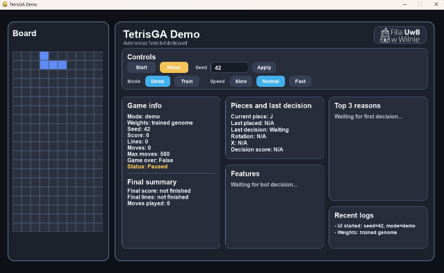

# Tetris Evolution AI

A deterministic Tetris simulator and a genetic algorithm that evolves the weights of a one-step heuristic bot. The project includes a Pygame dashboard, headless training and evaluation, and regression tests.

## How it works

The bot tries every rotation and horizontal position, simulates a straight drop, then scores the resulting board using eight weighted features: holes, total and maximum height, bumpiness, cleared lines, well depth, and row/column transitions.

Training evaluates each genome on the same ten seeds, selects parents with tournaments, combines their weights with uniform crossover, and applies bounded additive mutations. Elitism carries the best genome forward. Fitness rewards score, cleared lines and survival, with a penalty for variation between games. Five separate validation seeds and five test seeds support held-out evaluation; they are not used to select training parents.

The visual **Train** mode is a small, single-seed preview. It does not save its winner or replace the demo bot. Use the CLI to train and save a model.

## Run

Requires Python 3.10 or newer; tested with Python 3.12. Run commands from the repository root. On Windows:

```powershell
python -m venv .venv
.\.venv\Scripts\python.exe -m pip install -r requirements-dev.txt
.\.venv\Scripts\python.exe run_ui.py
```

On Linux/macOS, use `.venv/bin/python` in place of `.\.venv\Scripts\python.exe`. For runtime only, install `requirements.txt`.

The dashboard offers Demo/Train modes, pause, reset, speed controls, and a demo seed field. After a visual generation finishes, **Next gen** starts the next one.

For a short headless training run, followed by held-out evaluation:

```powershell
.\.venv\Scripts\python.exe main.py demo 100
.\.venv\Scripts\python.exe main.py train 20 --population-size 6 --generations 3
.\.venv\Scripts\python.exe main.py eval 100
.\.venv\Scripts\python.exe -m pytest
```

`python main.py train --help` lists the configuration options. Without overrides, training evaluates 30 genomes over 20 generations, up to 100 moves per game, and can take time. `--seed` controls reproducibility; `--model` and `--audit` accept custom output paths.

CLI training saves `models/best_genome.json`. Demo mode uses this model when present, otherwise built-in weights. Decision and training logs go to `audit/audit_log.jsonl`. Both files are generated locally and ignored by Git.

## Model limits

- Pieces are sampled independently and uniformly, rather than using a seven-bag randomizer.
- The bot changes rotation/column directly before dropping; it does not search movement paths or support wall kicks, hold, or lookahead.
- Scoring is 100 points per cleared line. The well feature sums column well **depths**, rather than triangular cumulative well counts.
- Bounded training and evaluation demonstrate the pipeline; they do not establish an optimal strategy or broad generalization.

## Structure

```text
core/        Board, pieces and game rules
ai/          Feature extraction and heuristic move selection
ga/          Genomes, fitness, genetic operators, training and model storage
simulation/  Headless game runner
data/        Fixed train/validation/test seed sets
ui/          Pygame rendering and dashboard panels
audit/       JSONL event logger
tests/       Game, AI, genetic algorithm, persistence, CLI and headless UI checks
```

Runtime uses Pygame; tests use pytest. The simulation and genetic algorithm use the Python standard library.


